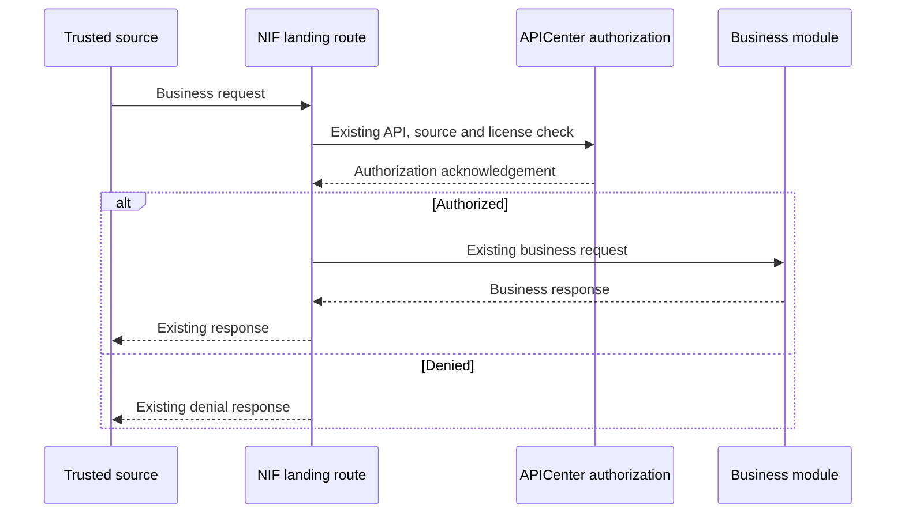
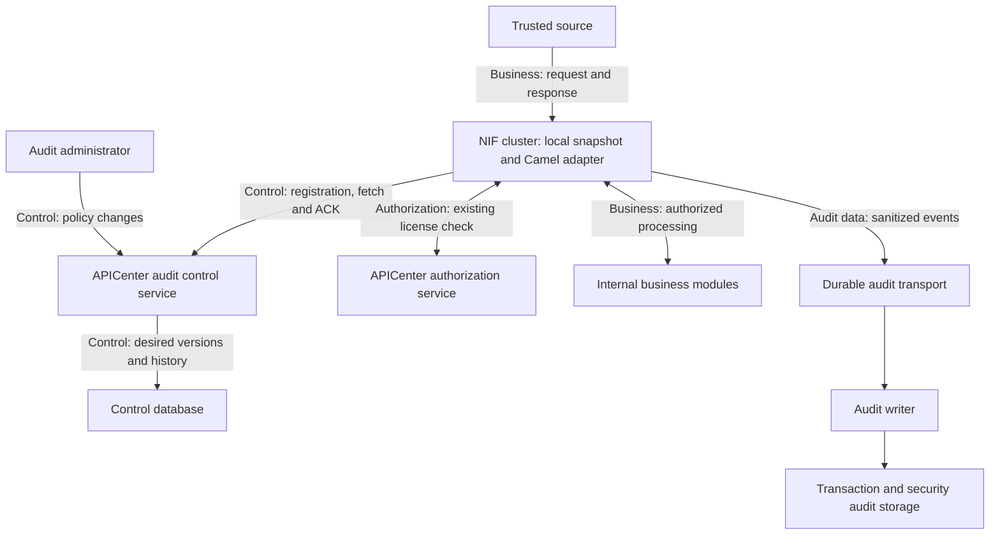
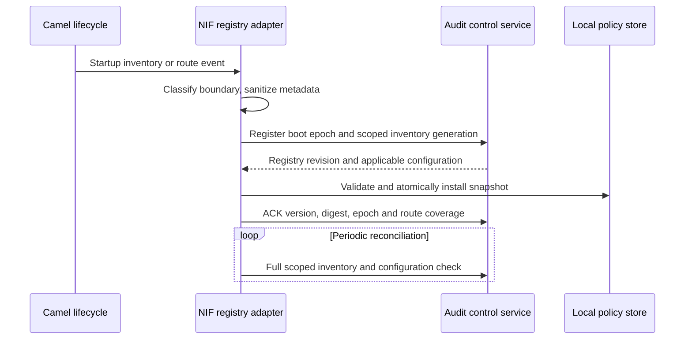
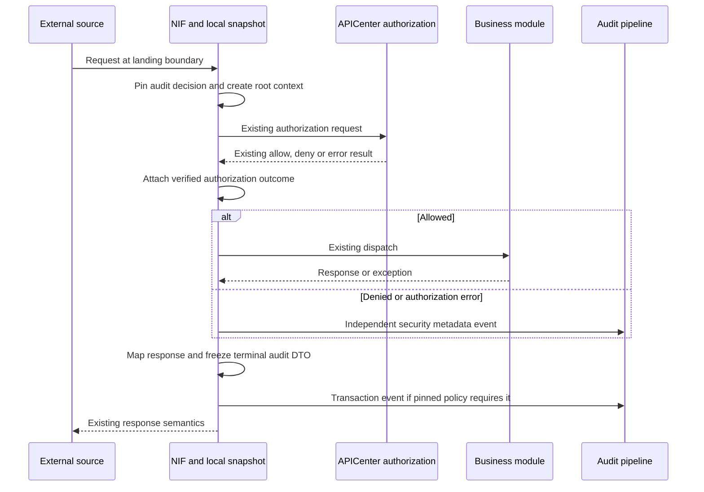
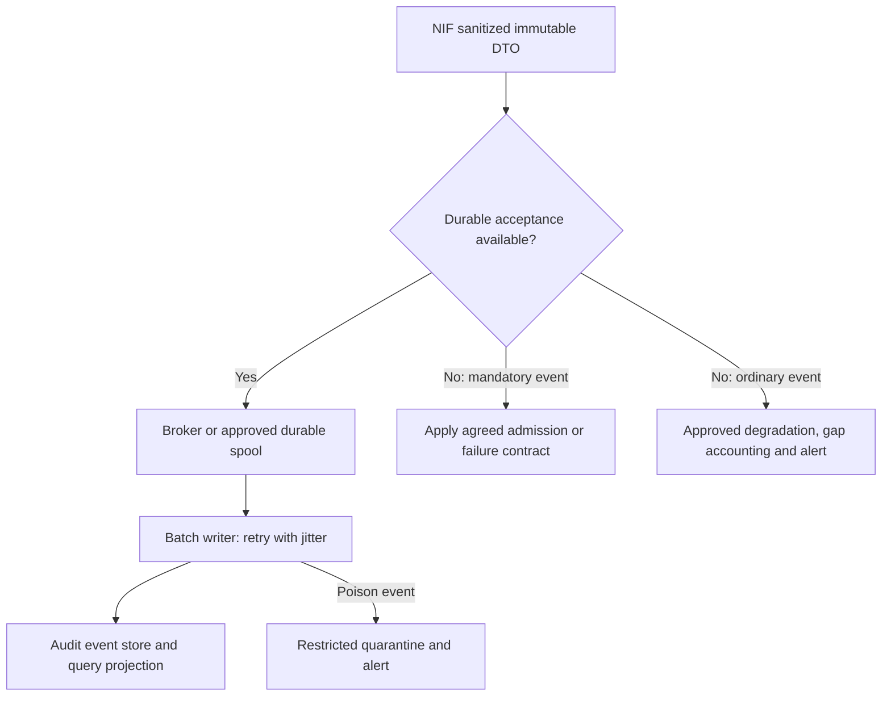
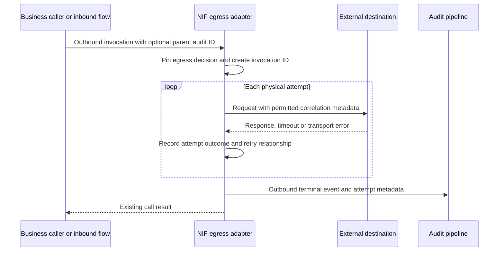
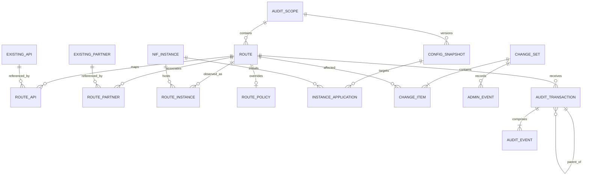

# Dynamic route-based API audit management

Proposed design and implementation brief · 25 November 2026

## Executive recommendation

Use APICenter as the administrative home **if its ownership, access controls and release process permit it**. Keep the audit configuration service as a separate logical component inside that application initially. NIF owns discovery, local policy enforcement and transaction capture. Preserve the current APICenter licensing and trusted-source authorization call exactly as it works today.

P1 needs a route registry, three-state route policy (`INHERIT`, `ENABLED`, `DISABLED`), a versioned configuration snapshot in each NIF instance, a centralized Camel adapter, and an audit persistence pipeline. An audit toggle changes capture decisions; it never stops a Camel route. Pin the capture decision and configuration version when a request enters an external boundary, and retain them through completion.

Start with an existing relational database for control-plane records and periodic snapshot retrieval over an authenticated internal API. Add broker notifications only if existing infrastructure or the propagation target justifies them. Audit event transport and storage are a separate throughput decision: reuse an existing suitable durable audit pipeline when available. A polling configuration mechanism does not imply a database write on every business request.

The UI must distinguish **saved desired policy**, **target effective policy**, and **the policy actually installed on each instance**. A failed node must remain visible as a coverage gap. No cluster-wide instantaneous change is promised.

Recommend metadata-only capture for the MVP. Treat ordinary transaction auditing, mandatory transaction auditing, security events and administrative configuration history as separate obligations. Disabling ordinary transaction capture cannot disable the latter two. The production default, which transaction classes are mandatory, retention and exhaustion behavior need owner decisions before production rollout; the prototype deliberately uses an enabled metadata-only default to demonstrate inheritance.

## 1. Confirmed requirements and assumptions

| Status | Item |
|---|---|
| Confirmed | External trusted source → NIF/Camel landing route → APICenter license and source/API authorization → NIF → internal monolithic module → NIF response. |
| Confirmed | P1 is inbound; P2 adds outbound. Route-level audit controls are primary. |
| Confirmed | Changes cannot require route reconstruction, suspension, restart or business-module changes. |
| Confirmed | Multiple NIF instances, shared routes, multiple APIs per route and multiple routes per API must work. |
| Confirmed | Configuration must be local on the request path, with administrative history independent of transaction toggles. |
| Unknown | Camel version, route DSLs, HTTP/message components, dynamic route creation method, deployment model, topology and existing audit components. |
| Unknown | Whether APICenter is the organizational owner of audit administration; audit data need not be stored in APICenter. |
| Proposed | APICenter-hosted control service, existing relational control database, authenticated conditional polling, immutable local snapshot and metadata-only P1 capture. |
| Proposed | Security and administrative metadata are always captured; regulated transaction classes have a non-disableable capture floor. Compliance must specify the exact classes and failure contract. |
| Prototype only | Fictional partners and routes, three sandbox NIF instances, browser-local state, enabled default and one initially failing instance. No real authorization, licensing, Camel runtime or durable audit backend is implemented. |

“Trusted source” is an existing managed identity. A header supplied by a caller is not proof of that identity. Reuse the validated identity and authorization outcome produced by NIF/APICenter.

### Existing inbound sequence



## 2. Architecture and ownership



These are logical components, not a mandate to create eight microservices. APICenter authorization and audit configuration may share an application while keeping endpoints, privileges and failure handling distinct. The audit writer may be part of an existing audit service. Database and broker products remain unselected.

| Administrative placement | Advantages | Costs / selection condition |
|---|---|---|
| APICenter module, recommended candidate | Reuses API/source catalog, administrator identity and UI navigation. | Confirm ownership and release cadence; isolate audit ingestion load and access from licensing. |
| Separate audit service with APICenter UI | Independent scale, ownership and storage boundary. | More deployment and authentication work; choose if an enterprise audit platform already exists or needs independent ownership. |
| NIF-hosted administration | Fewer initial integrations in a small deployment. | Control state must still be centralized across NIF instances; risk of fragmented UI and privileges. Suitable only where APICenter extension is impractical. |

No audit setting grants API access, changes a license, updates source/API entitlements or authorizes outbound calls. Metadata refresh is read/registration activity, not a route reload.

## 3. Registry, identity and discovery

Maintain two identities:

- **Logical route**: stable application-owned `routeKey`, scoped by account/tenant if applicable, environment, NIF deployment and logical Camel context. Give inbound and outbound boundaries distinct keys. Map the current Camel `routeId` and display name to this identity. Never use pod IP, an auto-generated Camel ID or display text as the durable key.
- **Route instance**: the logical route observed in a particular runtime instance and boot epoch, including definition version/digest, component capabilities and lifecycle status. The same logical route on three nodes is one UI row with three runtime observations.

A supplied stable UUID or explicit stable route ID is preferred. A renamed display label retains its key. A newly generated route key is a new policy target; never silently copy policy by fuzzy name matching. Require an explicit administrative migration if a true route replacement should inherit policy. A reused key with an incompatible direction, context scope or boundary role is rejected.

Proposed metadata includes route key, current Camel route ID, name/description, boundary role (`EXTERNAL_LANDING`, `EXTERNAL_EGRESS`, `INTERNAL`), direction, deployment/context, module, API mappings, possible partner/destination mappings, protocol, sanitized endpoint template, eligibility, definition digest/version, observed lifecycle, last sync and exclusion reason. Strip secrets and query values from endpoint URIs before registration.

Discovery strategy:

1. Enumerate Camel contexts and routes at startup and perform an authenticated full registration for this instance/boot epoch. Cross-check the existing API catalog rather than duplicating API definitions.
2. Use explicit route metadata to classify external boundaries. HTTP ingress is a useful hint, not sufficient classification; internal HTTP and external message consumers both exist.
3. Observe route add/remove/start/stop events and enqueue registry updates outside the Camel event thread. A dynamic route must receive the adapter and a usable local policy before it can accept traffic under the agreed readiness contract.
4. Reconcile a complete inventory periodically. A missing event must not leave permanent stale registry state.
5. Treat a full inventory as authoritative only for the reporting instance, context and completed generation. Partial updates never imply removal of omitted routes. Reject late generations from an old boot epoch.

Camel provides route lifecycle events via EventNotifier; its callbacks run on the current thread, so registration/network work must be deferred [S2]. Startup enumeration alone is insufficient for dynamic additions; lifecycle notifications alone can be missed. The combination is deliberate.

### Registration sequence



#### Mapping and lifecycle edge cases

| Situation | Behavior |
|---|---|
| Shared route / multiple APIs | Many-to-many mapping. P1 route switch affects every API through that boundary; UI previews that impact. |
| One API / several routes | Each route is independently configured and appears in API search results. |
| Multiple possible sources | Show associated sources as metadata; use authenticated request identity in audit records. Source filter does not create a source-specific policy. |
| Internal route chaining | Registry can display internal routes as excluded; a root audit context prevents another inbound transaction record. |
| Route on only some nodes | Target only hosting instances, with rollout coverage and lifecycle shown. Never expect ACKs from non-hosts. |
| One node removes a route | Update that observation; do not remove the logical route while other nodes still host it. |
| Route removed everywhere | Tombstone logical route after completed inventories and an operational grace period. Preserve policy/history references. |
| Instance misses heartbeat | Mark stale/unknown coverage. Do not claim applied just because its lease expired; prove drained/stopped via deployment membership before excluding it from the traffic-serving cohort. |
| Rolling deployment | Show route-definition mismatches and adapter capability mismatches. New instances install required policy before entering service. |
| One Camel route handles inbound and egress | Model distinct integration boundaries, or require explicit outbound integration keys in P2. A single direction flag on the route cannot describe both correctly. |

## 4. Policy model, inheritance and transaction semantics

### Keep P1 small

Store a scope default and one optional route override. Represent route configuration explicitly as `INHERIT`, `ENABLED`, or `DISABLED`; store absence/inheritance consistently, not an ambiguous nullable boolean. Keep mandatory requirements in a privileged policy constraint record, not a normal route toggle. For the MVP, capture level is fixed to metadata; do not ship a freeform payload switch.

Proposed resolution:

1. Resolve the scope default for an eligible external boundary.
2. Apply the explicit route override, if present.
3. Enforce mandatory event-class minima and privacy limits. A mandatory transaction route cannot resolve to disabled. A privacy prohibition cannot be overridden by enabling capture.
4. Produce an immutable decision containing route key, enabled flag, capture profile, policy version/digest, constraint version and resolution reason.

Security events and administrative events are separate event classes. They do not inherit an ordinary transaction `DISABLED` setting. Mandatory policies may require only particular metadata or a separately approved data projection; “mandatory” does not authorize unrestricted payloads.

| Configured | Default | Mandatory transaction floor | Target transaction audit |
|---|---|---|---|
| INHERIT | Enabled | No | Enabled; inherited |
| INHERIT | Disabled | No | Disabled; inherited |
| ENABLED | Either | No | Enabled; explicit override |
| DISABLED | Either | No | Disabled; explicit override |
| DISABLED | Either | Yes | Reject change; effective minimum stays enabled |
| Any allowed setting | Either | Yes | At least mandatory approved metadata |

Choose the production scope default using compliance needs, data classification, measured load and the current audit baseline. An enabled metadata-only default improves coverage but still carries identifiers and storage cost; disabled default reduces collection but needs explicit mandatory coverage. Neither is assumed to be the organization's current policy. During migration, preserve and map existing policy instead of silently resetting all routes to the prototype default.

### Future scopes only when justified

Do not add global, module, direction, API and partner switches simultaneously. They create conflicts on shared routes. If source/API specificity becomes a real requirement, add a scoped rule version with this explicit specificity order:

`scope default < route override < route+API < route+verified partner < route+API+verified partner`, followed by mandatory and privacy constraints.

The ordering between route+API and route+partner is a proposed product decision, not implicit “most specific wins.” Reject duplicate rules of identical specificity and do not use database insertion order to resolve ties. A constraint change invalidates all affected effective snapshots. Module and API filters remain navigation tools in P1.

For future rules based on identity learned only after authorization, pin the complete immutable rule snapshot at entry, then resolve using verified identity once known. Apply an explicit unknown-identity rule before that point. Do not re-read the newest rules mid-request, and do not capture raw payload speculatively before identity permits it.

### Pinning and in-flight work

At the first eligible inbound boundary, pin the decision from the instance's current snapshot. Policy changes affect subsequent entries on that instance. An already-started request keeps its decision even if the administrator saves or the node installs another version. That avoids an entry being captured under one setting and its completion being dropped under another.

Record both desired/target policy in the UI and actual instance version. If nif-03 still runs v17 while others run v18, traffic on nif-03 follows v17 and is labeled accordingly. An ACK means installation for new exchanges; it does not mean old exchanges have finished or audit records have reached storage.

## 5. Functional administrative UI

Proposed navigation: **Route policies**, **NIF instances**, **Change history**. Integrate these into APICenter's administration section if ownership is agreed.

The prototype implements:

- Inbound/outbound switching; counts for discovered and auditable routes, target enabled/disabled routes and outstanding updates.
- Search and filters by module, API, source/destination, target audit state, route lifecycle and propagation state.
- Individual three-state controls; bulk enable, disable and inherit; shared API/source mappings; excluded internal routes; mandatory-route protection.
- Unsaved drafts, review/save with a reason, immutable-style history, and rollback staged as a new version.
- Route details with configured/target policies and actual policy/version per host, metadata, history and simplified business flow.
- Cluster simulation with blocked updates, pending/partial/failed application and recovery through reconciliation.
- Exchange simulation that pins an instance's applied version, keeps it during policy changes, and captures a denied security event independently of the transaction setting.

Production change workflow:

1. Editing stages drafts. No HTTP write is issued by merely changing a selector.
2. Review shows old/new policies, every affected route/API, target hosts and mandatory exclusions. Always require a reason for disabling; a uniform reason requirement for all changes simplifies the MVP.
3. Save validates RBAC and mandatory constraints and uses optimistic concurrency. Commit desired version and administrative event atomically.
4. Display saved/pending immediately. As installations are acknowledged, show applied, partially applied or failed with per-node detail. Preserve unknown/offline targets in the coverage explanation.
5. Retry reconciles the latest desired snapshot; rollback is another reviewed change and version, never deletion of history.

Do not label this control “Start/stop route.” Use “Transaction auditing” with “Configured policy” and “Applied on instances.” The business route status is read-only on this screen. Apply as soon as each host installs the version; scheduled effective times require a later design for clock skew and rollout readiness. No synchronized effective timestamp is offered in P1.

The dashboard also needs in production: last registry sync, stale observations, target cohort coverage, collector backlog, oldest pending event, spool utilization, recent administrative changes and audit persistence errors. Pipeline health is a separate signal from configuration propagation.

The mock UI is intentionally not a secure audit store. Browser state can be altered or reset, transport failures are simulated, metadata refresh updates demo timestamps, and no role enforcement or real request is performed. These functions are clearly labeled in the UI. Production history must live server-side under the controls in section 11.

## 6. Camel integration and boundary capture

An initial adapter installation in NIF is necessary. The no-restart requirement applies to subsequent policy changes; it does not mean new runtime instrumentation can be installed into an otherwise unmodified process without a deployment.

| Mechanism | Useful for | Limit / proposed use |
|---|---|---|
| `RoutePolicy` / factory | Central attachment and per-route exchange/lifecycle callbacks. | Strong POC candidate for boundary entry; never invoke route-control operations. Validate ordering before authorization and behavior on your Camel version. |
| `interceptFrom` | Shared ingress logic for known consumer routes. | Entry capture, not the whole request/response lifecycle; broad matching includes internal routes. Dynamic coverage needs testing. |
| `interceptSendToEndpoint` | P2 producer boundaries, including dynamic endpoint URIs. | Must distinguish external services from APICenter, internal HTTP and the audit pipeline; define retries and completion correlation. |
| `InterceptStrategy` / async processor wrapper | Exact node boundaries and asynchronous before/after behavior. | More framework coupling; use only if simpler callbacks cannot expose the needed boundary safely. |
| Unit-of-work synchronization | One root completion and exception summary across internal chaining. | Validate consumer response timing, child units of work, handled exceptions and asynchronous ownership. |
| `onCompletion` | Convenient completion DSL with before/after consumer modes. | Route-scoped definitions override context-scoped ones; cannot assume a global definition covers all routes. |
| EventNotifier | Registry lifecycle and selected transport/exchange diagnostics. | Do not perform blocking I/O in the event thread or assume a completion event contains original payloads. |
| Explicit shared processor | Existing NIF authorization outcome / final response mapping boundary. | A small centralized hook is justified when lifecycle callbacks cannot identify semantic outcomes; avoid copy/paste in every route. |

Camel documents `onExchangeBegin` and `onExchangeDone` callbacks on RoutePolicy [S1]. Its interceptors distinguish each processing step, route ingress and endpoint send; `interceptSendToEndpoint` supports dynamic URIs, whereas directly constructed consumers are a stated `interceptFrom` limitation [S3]. Unit-of-work completion and the context/route onCompletion precedence are documented separately [S4]. These are integration candidates, not a claim that a specific mechanism is compatible with the undisclosed NIF version.

**Recommended POC:** central adapter registration, a route policy factory restricted by trusted boundary metadata, one request-owned audit context, a unit-of-work terminal callback, and a small hook in the existing common APICenter acknowledgement handler. Add a final response-mapping hook if necessary. Confirm behavior with the actual consumers and error handlers before choosing the production adapter. Runtime toggles then only replace local policy data; they never rebuild interceptors.

### Capture points and meaning

| Point | Capture | Meaning / caution |
|---|---|---|
| External arrival | Audit ID, route, receive time, safe endpoint/method, local decision/version, initial correlation. | Before authorization so denials and malformed attempts are visible. Avoid trusting claimed partner/GTRN. |
| Authorization ACK or failure | Verified source, resolved API, allow/deny/error, safe reason code, timing. | Observe the existing result. No duplicate authorization request. Distinguish denial from unavailable authorization. |
| Forward to module | Module key, dispatch time, sanitized logical target. | Does not establish successful business completion. |
| Module response | Completion time, safe business outcome code, status. | Error handled by Camel may still be a business failure; capture mapped outcome rather than only `exchange.getException()`. |
| Final NIF response mapping | Final transport status, response-ready time, mapped exception code. | “Response prepared” does not prove bytes were received by the external client. |
| Consumer/transport completion | Send failure/disconnect where the component exposes it. | If unavailable, record delivery outcome `UNKNOWN`; avoid a misleading “delivered” field. |
| Unhandled/handled exception | Category, sanitized code, failure stage and retry summary. | Preserve original/handled exception metadata where the adapter supports it; do not store unrestricted stack text or exception messages. |

### P1 audited request



The queue arrows show logical production, not an assertion that asynchronous enqueue is already durable. Mandatory acceptance ordering is addressed in section 9.

### Request-owned state and duplicate prevention

Use an exchange-associated context containing root audit ID, boundary key/direction, immutable decision, start time, GTRN, optional trace ID, authorization result, safe request projection, completion guard and child invocation links. Do not keep mutable request state in singleton processor fields, thread locals or MDC alone. The existing GTRN generator may remain; copy its value to the request context when available. A trace ID is useful linkage but trace sampling or exporter failure cannot govern audit creation.

Only an eligible external boundary creates a root P1 transaction. Internal `direct:`/processing route entries observe the root and do not create another. Do not use a single boolean `alreadyAudited` for all directions: P2 egress calls are distinct audit entities linked to the root. Splits, multicasts and asynchronous child exchanges need an explicit child-context propagation policy; never copy a mutable terminal-completion guard as if each child were the root. Use atomic finalize-once per owned boundary plus a storage uniqueness key. Business retries remain attempts of the logical invocation unless a new upstream request actually arrives.

Framework-neutral pseudocode, not drop-in Java:

```text
on external boundary entry:
    identify stable boundary key from trusted route metadata
    if no context owned by this boundary:
        snapshot = localStore.current()       // in-process read only
        decision = resolve(snapshot, boundary)
        ctx = new request-owned context(decision, ids, timestamps)
        attach ctx and exactly one terminal callback
        capture allowlisted entry metadata without consuming a stream
        if mandatory: durably accept START before business forwarding

on existing authorization result:
    update ctx with verified API/source and outcome
    if denied/error: emit required security event independently

on mapped response / terminal callback:
    if ctx.finalizeOnce():
        terminal = freeze sanitized DTO; never enqueue the Exchange
        if decision requires transaction capture:
            enqueue using the agreed ordinary/mandatory failure contract
```

For asynchronous processors, preserve callback and unit-of-work semantics; never block an I/O event loop waiting on a database. Completion DTOs must own copies of allowed data before handing off to a background worker, since the exchange and stream lifetime may have ended.

### Payloads, streams and response boundaries

P1 captures no request/response body. If an approved P1 enhancement needs selected fields, extract only schema-allowlisted projections with size limits and masking before enqueueing. Binary, multipart and unclassified payloads remain metadata-only. Capture omission/truncation/masking reasons explicitly.

Camel streaming bodies may be readable only once; stream caching supports rereading and can spool to temporary files [S5]. Audit code must not call `getBody(String.class)` indiscriminately. Enabling caching is a route-capacity/security decision, not a free solution: validate compatibility, reset/read ownership, byte caps, encrypted spooling, file permissions, disk exhaustion and cleanup. A body transformed by the route is not the original request; choose the intended capture boundary explicitly.

## 7. Dynamic configuration and cluster consistency

### Mechanism comparison

| Mechanism | Latency / reliability | Complexity / verdict |
|---|---|---|
| Local cache, conditional REST polling | Convergence bounded by interval plus recovery; no per-request remote call. Full snapshots repair gaps. | Lowest infrastructure burden; recommended baseline when seconds-level updates are acceptable. |
| Each NIF polls database directly | Similar latency; couples runtimes to schema and database credentials. | Simpler only if this is already the established platform pattern. Prefer service ownership of control data. |
| Direct REST push | Fast while reachable; caller must track node discovery, retry and partitions. | Use only as a notification hint with reconciliation. Avoid exposing admin write endpoints on every NIF. |
| Redis Pub/Sub | Low latency; disconnected subscribers can miss notifications. | Reuse existing Redis only as invalidation, never sole source of truth or sole update path. |
| Existing durable broker | Fast delivery with replay depending on configuration; duplicates and stale delivery still possible. | Good when already operated. Fetch/validate latest snapshot on notification; do not add a broker just for a few policy switches. |
| Event-driven hint + reconciliation | Fast common case, periodic repair. | Recommended enhancement if the propagation SLO or existing infrastructure justifies it. |

No exact interval or broker is fixed without scale and network evidence. For a POC, a jittered 10-second conditional poll and a periodic full reconciliation are reasonable *test settings*, not a promised production SLO. Heartbeats and inventory cadence are separate tunables. Large estates may use scoped deltas plus occasional full snapshots.

### Change commit and installation

```mermaid
sequenceDiagram
    participant U as Administrator UI
    participant C as Control service and database
    participant N1 as NIF instance 1
    participant N2 as NIF instance 2
    U->>C: Change with reason and expected revision
    C->>C: Validate and atomically commit policy, history and outbox
    C-->>U: Saved v18, target instances pending
    N1->>C: Conditional configuration fetch
    C-->>N1: Complete snapshot v18 and digest
    N1->>N1: Validate, checkpoint and atomically install
    N1->>C: ACK installed v18, digest and boot epoch
    N2->>C: Configuration fetch fails
    C-->>U: Partially applied; instance 2 retains v17
    N2->>C: Later reconciliation fetch
    C-->>N2: Latest snapshot
    N2->>N2: Install latest snapshot
    N2->>C: ACK installation
    C-->>U: Applied to known traffic-serving cohort
```

The database is the desired-state authority. Use a monotonic configuration version per tenant/environment/deployment scope, with route-specific last-change versions if useful for the table. Serialize version allocation inside the database transaction. Commit policy rows, administrative event and notification outbox together. With polling alone, the outbox can be omitted; do not make notification delivery a condition for finding a committed policy.

NIF validates scope, schema version, digest/signature as applicable, required adapter capabilities, stable route mappings and monotonic version. Fetch the newest authoritative snapshot after an invalidation rather than trusting an arbitrary event payload. Store the verified snapshot as a bounded local checkpoint, then install one immutable in-memory reference. ACK only after activation; include boot epoch, version, digest and actual covered boundary keys. Persist-before-activation can recover on restart, but restart still needs readiness validation against the required bootstrap policy.

Reject older versions and late ACKs from previous boot epochs. If only part of a snapshot is compatible, reject that installation or explicitly ACK route-level coverage and failure; never report the whole snapshot applied. New joins are not covered by an earlier rollout's success unless their readiness install is verified. Route removals and membership changes update the target cohort through independently verified deployment state.

### Propagation states

| State | Meaning |
|---|---|
| Draft | Browser/user changes not committed. |
| Configured / saved | Desired state committed with administrative history. |
| Pending | Target hosts have not yet acknowledged the relevant version. |
| Applied | Every known traffic-serving target has installed the required policy/digest; in-flight transactions may still use older versions. |
| Partially applied | At least one host has applied it and at least one has failed, is pending or has unknown coverage. |
| Failed | No target applied it and a failure/timeout is established. Preserve error codes and retry state. |
| Stale / unknown | Reporting or membership is uncertain. Surface this even if the last reported version matched. |

### Startup, outage and stale-policy behavior

| Condition | Proposed behavior |
|---|---|
| Warm runtime; control service unavailable | Continue using last verified installed snapshot. Alert with version and age. Existing authorization behavior is untouched. |
| Restart with valid checkpoint | Verify integrity and scope; check readiness/mandatory requirements. Permit service only within the approved stale-policy contract. |
| Cold start; no usable policy | Use an explicitly provisioned bootstrap policy. If mandatory obligations cannot be established and accepted durably, do not mark the instance ready. Do not silently choose disabled. |
| Missed notification | Conditional polling/full reconciliation installs current desired state. |
| Invalid snapshot | Keep last known good snapshot, reject and ACK failure with safe diagnostic code. |
| Audit-disabled snapshot becomes too old | Staleness deadline may require approved metadata-only fallback or loss of readiness. The deadline and fallback are compliance/availability decisions, not arbitrary runtime guesses. |
| APICenter authorization unavailable | Follow current NIF/APICenter authorization failure semantics. Audit configuration availability must never create a new authorization bypass. |

For normal routes, prefer continued business availability with last known good capture policy and visible degradation. For mandatory classes, define a maximum permitted policy age and durable audit-acceptance condition. Unbounded “last known good” can leave an old disabled policy running indefinitely; it needs an explicit bound or an approved exception.

## 8. Audit records and correlation

Use distinct identifiers and semantics:

| Field | Purpose |
|---|---|
| `auditId`, `eventId`, `eventType`, `schemaVersion` | Logical boundary audit and idempotent immutable stage events such as START, TERMINAL or SECURITY. |
| `parentAuditId`, `invocationId`, `attemptId` | P2 links and retries; optional for simple P1. |
| GTRN / correlation ID | Existing business-request correlation; generate or validate at NIF. External claims remain separate if untrusted. |
| Trace/span IDs | Optional trace linkage. Auditing never depends on recording/sampling/export success. |
| Scope, route key, Camel route ID, context, definition revision | Stable target and actual executing definition. |
| API IDs, module, verified source/destination | Business meaning. Record unresolved identities explicitly. |
| NIF instance and boot epoch | Actual runtime and installation identity. |
| Policy version/digest, constraint version, resolution reason | Explain why capture occurred. |
| Arrival, authorization, dispatch, response-ready, completion and ingestion times | Latency breakdown and processing timeline. Use monotonic duration measurements inside a process and UTC wall time for correlation. |
| Method, sanitized endpoint template, transport/business status | Safe request and response metadata. Strip query values, credentials and customer identifiers from URLs. |
| Authorization outcome and safe reason code | ALLOWED, DENIED, ERROR or UNRESOLVED; denial is different from a transport outage. |
| Outcome/failure stage, bounded exception classification, retry count | Terminal meaning including handled failures, timeout, cancellation and incomplete execution. |
| Capture profile, allowed projection or payload reference | Future approved payload capture only; include size, omitted/truncated flags and masking version. |
| Integrity / retention class | Store record digest, retention class and legal-hold association where required. |

Application logs aid troubleshooting; traces describe sampled execution; audit events establish specified activity and accountability. They can link through GTRN/audit IDs, but an OTel appender or trace exporter is not the persistence contract for this audit design.

Store immutable events with a query projection for “one transaction row.” A SECURITY event and a transaction TERMINAL event can describe the same denied request without being accidental duplicates: event type and linked audit ID explain their different purposes. Do not count them as two business transactions in analytics.

## 9. Persistence, reliability and capacity

### Options and selection

| Option | Strength | Limitation |
|---|---|---|
| Synchronous remote database insert | Simple acceptance semantics at modest load. | Adds latency and ties business availability to database connectivity. Do not put this in generic Camel callbacks without a measured need. |
| In-memory queue + writer | Low overhead and batching. | Loses accepted-but-unflushed events on crash. Not a durable compliance acceptance boundary. |
| Existing durable broker + idempotent writer | Buffering, replay, independent consumer scaling. | Broker operations, partition ordering and retry ownership must be defined. Preferred if already available and suitable. |
| Bounded durable local spool + forwarding | Short outage absorption without immediate remote dependency. | Node/disk loss, encryption and disk exhaustion remain risks; local durability is weaker than replicated acceptance. |
| Existing enterprise audit service | Reuses integrity, retention and query capability. | Verify its API, durability guarantee, throughput, tenant isolation and outage behavior before selecting it. |

Recommend asynchronous immutable DTO delivery with a bounded durable acceptance path selected from existing infrastructure. Do not require both a new broker and a new local spool by default. Use batching in the writer, with limits by time and bytes. Transaction/search storage may be a relational store at moderate volume; higher volume may justify partitioned event storage and a separate index. Keep control configuration and high-volume audit ingestion logically separated.



### Failure contract must be explicit

For **ordinary auditing**, keep business availability where agreed, absorb outages in the selected bounded buffer, retry and alert. At capacity, either reject/admit-throttle affected new work under an approved contract or continue business with a recorded audit coverage incident and quantified gap. There is no mechanism that guarantees unlimited lossless auditing, bounded resources and uninterrupted processing throughout an arbitrary storage outage. The latter mode is an explicit exception, never silent dropping.

For **mandatory auditing**, establish durable START acceptance before a new request is forwarded to business processing. If no acceptable durable path is available, apply the agreed admission failure contract. Persist terminal outcomes durably as far as possible and reconcile STARTs lacking TERMINAL events as INCOMPLETE after a defined threshold. A JVM crash can leave a genuine unknown outcome; do not invent a successful result. If the terminal audit fails after the business side effect, do not report the business action as rolled back or blindly retry it. Escalate the audit incident and use business idempotency/reconciliation.

Enabling a mandatory record type is consequently more than an audit toggle: it needs a failure contract and capacity. If the organization requires “no business interruption under every condition,” it must explicitly accept a bounded or unbounded audit-loss risk. Make that decision before calling the implementation compliant.

### Delivery and writer behavior

- At-least-once delivery; producer retries retain the same event ID. Enforce uniqueness on `(scope, eventId)` or equivalent. Do not advertise exactly-once end-to-end business processing.
- Partition/order by audit or invocation ID when needed. START/TERMINAL may arrive out of order; projection updates use event stage/sequence and never regress completed state to started.
- Retry transient failures with bounded concurrency and backoff/jitter. Quarantine invalid events under restricted access, retaining ID, reason and operational ownership; do not poison the whole queue or log raw payloads.
- Monitor produced, durably accepted, consumed, persisted, retried, quarantined and rejected counts; queue bytes, age, spool capacity, writer latency and end-to-end lag. Assign an on-call owner and severity thresholds.
- Keep BEGIN/TERMINAL event counts consistent enough to identify incomplete requests and coverage gaps. Writer and pipeline health do not change a successful configuration ACK into evidence of durable record storage.

### Capacity example, not a workload estimate

At 200 audited requests/second and 2,000 stored bytes per complete transaction including stage overhead, raw storage is `200 × 86,400 × 2,000 = 34.56 GB/day`; 30 days is about 1.04 TB before indexes, replication, security events and backups. A second event does not double that figure if the 2,000-byte assumption already includes both events. Tenfold payload growth or three replicas changes the budget accordingly. Size the outage buffer as event byte rate × tolerated outage duration plus operational headroom. Measure actual DTO size and sustained/peak rate before choosing storage or retention.

## 10. P2 outbound integration

The first question is whether outbound traffic actually traverses NIF. Inventory direct module HTTP clients, SDKs, schedulers and message producers. Their traffic is outside the NIF adapter's coverage until it is routed through NIF or separately instrumented. Display coverage limitations; do not infer complete outbound coverage from an empty route table.

Identify each external egress integration using a stable destination key, sanitized endpoint pattern and logical invocation boundary. A `direct:` consumer may be the start of an outbound route even though it is internal; classification depends on the external producer boundary, not the consumer protocol alone. One route with multiple or dynamic destinations needs destination mapping validation and potentially multiple integration-boundary keys.



One inbound audit can link to zero or many outbound invocation audits. An inbound root marker must not suppress them. One outbound logical invocation can have multiple physical attempts, with distinct attempt numbers/IDs and one final summary. A module resend that creates a new invocation is not automatically the same retry. Define this against the actual retry layer so Camel redelivery and HTTP-client retries are not double counted.

For asynchronous dispatch, “sent to broker” or “accepted by remote endpoint” is not eventual external business completion. Record dispatch acceptance and link any callback as a separate event/boundary. Pin policy at each outbound invocation; if it starts later than its parent inbound request, it may legitimately use a newer policy. Record both versions.

Reuse scope/versioning, UI controls, local snapshots, event envelope, history and integrity. Reuse authorization/licensing **only if** an existing outbound model actually requires it; do not assume inbound license semantics apply to a destination.

## 11. Security, privacy, integrity and retention

| Control | Proposed requirement |
|---|---|
| RBAC | Separate route-metadata viewer, policy editor, mandatory-policy administrator, audit-data viewer and retention operator. Scope permissions by environment/tenant/module as appropriate. |
| Service identities | NIF may register its own observations, fetch its own scope and ACK its own boot epoch. It cannot change desired policy or fabricate another node's ACK. Authenticate internal calls with the platform's supported service identity mechanism. |
| Administrative writes | Server-side validation, request forgery protection for browser-authenticated endpoints, optimistic concurrency, bulk limits and idempotency. Mandatory changes may need maker/checker if organizational policy requires it. |
| Sensitive data | No Authorization/Cookie/session headers, API keys, passwords or secrets. Use approved safe headers and schema projections, not redact-everything-by-regex after collection. Default body capture off. |
| Customer/financial data | Minimize identifiers and use tokenization/pseudonymization where permitted. Maintain a masking/classification version. If parsing/masking fails, omit the payload and emit a safe reason. |
| Transport/storage | Encrypt traffic, databases, approved spool and backups; separate keys and access for payloads if later introduced. Do not leak endpoint credentials or secret query values into registry or errors. |
| Integrity | Database roles prevent ordinary application users from modifying/deleting history and audit events. Add protected append-only storage or WORM/externally anchored tamper evidence when required. Hashes alone do not stop a privileged attacker rewriting data and hashes together. |
| Administrative history | Commit desired policy and history together; block the configuration write if its history cannot be committed. Include actor, reason, old/new values, version, scope, time and request ID. Installation results are separate immutable history events/projections. |
| Retention | Approve periods separately for transaction metadata, payloads, security events and administrative history. Apply legal holds; restrict purge jobs and audit purge execution/counts. No arbitrary legal retention period is assumed. |
| Tenant separation | Include scope in keys, queries, authorization and storage access paths. Enable database isolation mechanisms where supported; do not trust a client-provided scope alone. |

Do not include unnecessary personal data in the immutable administrative trail, because immutability and lawful erasure obligations must be reconciled by the organization. Raw credentials should never enter audit events at all. Always-on security capture also needs capacity, denial-of-service controls and a defined incident policy; aggregation of excessive attack events must be an explicitly approved, observable exception, not a hidden sampling shortcut.

## 12. Logical data model

Types are portable suggestions (`uuid`, `text/varchar`, `bigint`, UTC timestamp, JSON/document column where supported). Adapt to the existing database. API, trusted-source and license tables below are **existing APICenter entities**, not new audit-owned copies. Where databases differ, use validated external IDs rather than pretending cross-database foreign keys exist.



### Tables, keys and constraints

| Table | Principal columns | Keys / constraints |
|---|---|---|
| `audit_scope` | scope_id, tenant/account, environment, deployment_key, default_enabled, default_profile, current_version | PK scope_id; unique scope dimensions. Tenant column optional only if deployment is conclusively single tenant. |
| `route` | route_pk, scope_id, route_key, logical_context_key, direction, boundary_role, name, description, module_id, eligible, exclusion_reason, retired_at | PK route_pk; unique(scope_id, logical_context_key, route_key, direction); immutable identity dimensions. Internal boundary cannot be transaction eligible. |
| `route_api` | route_pk, api_id, api_version_ref | Composite PK(route_pk, api_id, api_version_ref); existing API reference. Never inferred one-to-one. |
| `route_partner` | route_pk, partner_id, relationship_type | Composite PK(route_pk, partner_id, relationship_type); existing source/destination IDs. Association is not authorization. |
| `nif_instance` | instance_pk, scope_id, runtime_id, boot_epoch, started_at, heartbeat_at, membership_state, adapter_version, capabilities | PK instance_pk; unique(scope_id, runtime_id, boot_epoch). No reuse of the old epoch on restart. |
| `route_instance` | route_pk, instance_pk, camel_route_id, definition_revision/digest, lifecycle, inventory_generation, last_seen_at, removed_at | PK(route_pk, instance_pk); lifecycle observations belong here, not only on the logical route. |
| `route_policy` | route_pk, mode, updated_version, updated_by, updated_at | PK/FK route_pk; enum/constraint mode in INHERIT/ENABLED/DISABLED. Validate mandatory floors in transaction, not only UI. |
| `policy_constraint` | constraint_id, scope_id, route_pk or approved selector, event_class, min_profile, enabled_required, version | PK constraint_id; deterministic resolution; privileged updates. P1 can restrict selectors to route keys. |
| `config_snapshot` | scope_id, version, schema_version, canonical_document, digest, created_at | PK(scope_id, version); immutable complete effective configuration and referenced constraints. |
| `change_set` | change_id, scope_id, expected_base_version, committed_version, actor_id, reason, request_id, created_at | PK change_id; unique(scope_id, request_id); unique(scope_id, committed_version) for policy changes. |
| `change_item` | change_id, route_pk, old_document, new_document | PK(change_id, route_pk); immutable items. Scope-default/constraint edits need typed targets in the enhanced schema. |
| `instance_application` | scope_id, target_version, instance_pk, target_route_digest, applied_version, applied_digest, status, error_code, requested_at, installed_at, ack_at | PK(scope_id, target_version, instance_pk); history retained per rollout; latest projection separate if needed. |
| `admin_event` | event_id, scope_id, change_id, event_type, actor/service_id, safe_detail, created_at, integrity_ref | PK event_id; append-only permission; covers changes, rollout ACK/failures and authorized purge events. |
| `config_outbox` | outbox_id, scope_id, version, type, created_at, published_at, attempt_count | PK outbox_id; unique(scope_id, version, type); required only if notifications are used. |
| `audit_transaction` | audit_id, scope_id, parent_audit_id, route_pk, invocation_id, GTRN, source/destination/API IDs, direction, instance_pk, policy_version, started_at, completed_at, terminal_state | PK(scope_id, audit_id); projection may initially be incomplete; immutable source events remain authoritative. Parent must be same authorized scope. |
| `audit_event` | event_id, scope_id, audit_id, event_type, sequence_no, occurred_at, ingested_at, safe_document, schema_version, integrity_ref, retention_class | PK chosen for partition engine; enforce logical uniqueness(scope_id,event_id); link to transaction. Account for database partitioning restrictions on global unique keys. |
| `payload_object` (later) | payload_ref, scope_id, encrypted_storage_key, hash, size_bytes, masking_version, retention_class, purge_at | No raw payload inline in control tables; separately protected access and expiry. |

Additional query indexes:

- Registry: `(scope_id, direction, module_id, retired_at)`; route mappings indexed by API and partner; observations by `(instance_pk, lifecycle, last_seen_at)`.
- Propagation: `(scope_id, status, target_version)` and `(instance_pk, ack_at)`; heartbeat/membership index for stale detection.
- History: `(scope_id, created_at DESC)`; change items by `(route_pk, change_id)`.
- Audit queries: time partitions plus `(scope_id, GTRN, started_at)`, `(scope_id, route_pk, started_at)`, `(scope_id, terminal_state, started_at)` and optionally API/partner/time. Avoid indexing every JSON field.

Retire registry observations/logical routes with tombstones. Retain identity rows or immutable historical identity snapshots while referenced by history/audits. Keep snapshots long enough to explain retained audit decisions; reconcile this with archive policy. Partition transaction events by ingestion or occurrence time with late-event handling; enforce event idempotency in a dedup ledger if the storage engine cannot enforce the logical key across partitions. Purge whole eligible partitions where possible, respecting legal holds and the separately approved administrative-history retention. Do not cascade-delete history when a route or APICenter API is removed.

## 13. REST API contract

Paths are proposed, versioned internal API names. Scope is server-authorized, not simply trusted because it appears in the URL. Registry, configuration and history endpoints use management service identities/roles; transaction ingestion uses a separate data-plane service identity.

| Method / path | Purpose |
|---|---|
| `PUT /audit/v1/scopes/{scope}/instances/{instance}/boots/{epoch}/inventory` | Idempotent full scoped registration with generation, context and `complete=true`; route lifecycle metadata and capabilities. |
| `POST /audit/v1/scopes/{scope}/instances/{instance}/heartbeats` | Liveness, boot epoch, installed digest and operational diagnostics. |
| `GET /audit/v1/scopes/{scope}/routes?...` | Cursor-paginated registry; filters for direction/module/API/partner/audit/lifecycle/sync. |
| `GET /audit/v1/scopes/{scope}/routes/{key}` | Route metadata, mappings, target policy, runtime observations and constraints. |
| `POST /audit/v1/scopes/{scope}/change-sets` | Atomic individual or bulk desired-policy update; one-item array is an individual update. |
| `GET /audit/v1/scopes/{scope}/configuration` | Effective scope snapshot, conditional ETag retrieval; optional authorized instance filtering without inconsistent snapshot versions. |
| `GET /audit/v1/scopes/{scope}/routes/{key}/effective-policy` | Explain inheritance, constraints and actual per-instance versions. |
| `POST /audit/v1/scopes/{scope}/instances/{instance}/applications` | Idempotent installed/rejected ACK for exact boot epoch, version/digest and coverage. |
| `GET /audit/v1/scopes/{scope}/change-sets/{changeId}` | Saved change, target cohort and rollout outcomes. |
| `POST /audit/v1/scopes/{scope}/reconciliation-requests` | Request accelerated refresh/retry; normal polling still repairs missed requests. |
| `GET /audit/v1/scopes/{scope}/history?routeKey=...&cursor=...` | Paginated administrative history with old/new values and propagation events. |
| `GET /audit/v1/scopes/{scope}/instances` | Membership, installed versions, last sync and unknown coverage. |
| `POST /audit-data/v1/events:batch` | Only if service ingestion is selected; bounded sanitized events, durable acceptance and per-event IDs. Broker deployment can use a schema-equivalent event contract instead. |

### Register inventory

```json
{
  "bootEpoch": "b8a1c9c2-16f4-4f71-a33d-78dc5d865070",
  "generation": 9,
  "contextKey": "nif-core",
  "complete": true,
  "adapterVersion": "poc-1",
  "capabilities": ["metadata", "root-completion", "auth-outcome"],
  "routes": [
    {
      "routeKey": "loan-intake",
      "camelRouteId": "loan-intake-v2",
      "direction": "INBOUND",
      "boundaryRole": "EXTERNAL_LANDING",
      "moduleId": "LMS",
      "apiIds": ["loan.create", "loan.status"],
      "sourceIds": ["partner-alpha", "partner-beta"],
      "definitionRevision": "2026.11.1",
      "definitionDigest": "sha256:example-definition",
      "lifecycle": "STARTED",
      "endpointTemplate": "POST /external/loans",
      "auditEligible": true
    }
  ]
}
```

The full inventory applies only to the declared instance/boot/context. Repeated generation+digest is idempotent; reused generation with different contents returns a conflict. The service validates API IDs and eligibility/classification against approved metadata; NIF cannot turn off a mandatory rule by changing its registration.

### Save an individual or bulk change

`POST /audit/v1/scopes/sandbox-nif/change-sets` with `If-Match: "cfg-17"` and `Idempotency-Key: 78aa-example`:

```json
{
  "reason": "Temporarily pause ordinary metadata capture during approved investigation",
  "changes": [
    {"routeKey": "loan-intake", "mode": "DISABLED"},
    {"routeKey": "loan-docs", "mode": "INHERIT"}
  ]
}
```

Successful response: `201 Created`, `Location` of the change, and `ETag: "cfg-18"`:

```json
{
  "changeId": "chg-018",
  "desiredVersion": 18,
  "configurationState": "SAVED",
  "propagationState": "PENDING",
  "effectiveTime": "ON_INSTANCE_INSTALLATION",
  "targets": ["nif-01", "nif-02", "nif-03"],
  "securityAuditing": "REQUIRED_INDEPENDENTLY",
  "historyCommitted": true
}
```

Validate every item before commit; reject the whole bulk change if any item is invalid. The production UI may offer to restage only valid selections, but must not quietly partially save. Duplicate route keys, foreign-scope keys, retired targets, forbidden DISABLED settings and unsupported modes are rejected. Apply a bounded bulk limit with a clear error. The prototype intentionally skips mandatory items when *staging* a bulk disable and tells the user; server-side atomic validation remains required.

Return `412 Precondition Failed` for stale `If-Match`, `428 Precondition Required` when missing, `422` for invalid/mandatory policy combinations, `403` for insufficient permission, and `409` for incompatible registry/membership changes or an idempotency key reused with different content. Same idempotency key and same canonical request returns the original result, without another version. Do not trust an actor supplied in request JSON; derive actor identity from authentication.

### Configuration and effective policy

`GET .../configuration` with `If-None-Match: "cfg-17"` returns `304` if unchanged, or:

```json
{
  "scope": "sandbox-nif",
  "version": 18,
  "schemaVersion": 1,
  "digest": "sha256:example-config-18",
  "defaultPolicy": {"enabled": true, "captureProfile": "METADATA"},
  "routes": [
    {
      "routeKey": "loan-intake",
      "configuredMode": "DISABLED",
      "effectivePolicy": {"enabled": false, "captureProfile": "METADATA"},
      "resolution": "ROUTE_OVERRIDE",
      "mandatoryEventClasses": ["SECURITY"],
      "constraintVersion": 4
    }
  ]
}
```

This is an abbreviated example; a full snapshot must include every route in its declared scope or explicit complete/delta semantics. For a disabled transaction policy, `captureProfile` is the allowed profile if capture applies; it does not mean a body is captured. Canonical snapshot digest excludes volatile generated-at/heartbeat fields. Optional per-instance effective response:

```json
{
  "routeKey": "loan-intake",
  "desiredVersion": 18,
  "targetEnabled": false,
  "propagationState": "PARTIALLY_APPLIED",
  "instances": [
    {"instanceId": "nif-01", "installedVersion": 18, "enabled": false, "state": "APPLIED"},
    {"instanceId": "nif-02", "installedVersion": 18, "enabled": false, "state": "APPLIED"},
    {"instanceId": "nif-03", "installedVersion": 17, "enabled": true, "state": "FAILED", "errorCode": "CONFIG_FETCH_TIMEOUT"}
  ]
}
```

### Instance ACK

```json
{
  "bootEpoch": "b8a1c9c2-16f4-4f71-a33d-78dc5d865070",
  "targetVersion": 18,
  "installedVersion": 18,
  "installedDigest": "sha256:example-config-18",
  "coveredRouteKeys": ["loan-intake", "loan-docs"],
  "coverageCompleteForInstance": true,
  "state": "APPLIED",
  "installedAt": "2026-11-25T09:50:00Z",
  "errorCode": null
}
```

Coverage is verified against that instance's registered hosting inventory and required route digest. The sample lists two routes for a hypothetical host with those two routes. The server records its own receipt time; node clock time is diagnostic. Duplicate ACKs are idempotent. Unknown version/digest, foreign instance and stale epoch do not advance rollout success. Rollback uses the change-set endpoint with an older desired value and a *new* version, subject to current constraints and concurrency checks.

## 14. Implementation roadmap and exit criteria

| Phase | Deliverables | Exit evidence |
|---|---|---|
| P1 discovery/adapter spike | Actual Camel version/component inventory, route boundary metadata, dynamic registration experiment, exception/async/stream review. | Demonstrate one root audit per external request on actual NIF routes; denied and handled-error paths covered. |
| P1 MVP | Route registry and many-to-many mappings, default+route policy, metadata capture, scoped local snapshots, polling/reconciliation, review/save UI, per-instance ACKs, immutable admin history and basic RBAC. | No request-path config calls; toggles never alter route status or authorization; cluster failure/recovery visible. |
| P1 production reliability | Chosen durable acceptance path, backpressure contract, masking/privacy enforcement, collector health, startup readiness and retention controls. | Measured throughput/latency, queue-full/outage/crash recovery and permission tests. Required before mandatory/compliance rollout. |
| P1 enhancements | Source/API rules only if needed; approved projections, maker/checker if required, richer bulk workflow, accelerated notifications and monitoring. | Rules deterministic on shared routes; no unrestricted payload mode; no hidden partial bulk commits. |
| P2 | Outbound coverage inventory, destination catalog/boundaries, invocation/attempt model, parent linkage, retry and async semantics, outbound UI and controls. | Multiple egress calls correlate correctly; inbound marker does not suppress egress; bypass traffic is documented. |

Bulk actions are included in the prototype for review. They can be enabled after single-route server validation is established. Reconciliation, minimal masking/allowlisting, basic backpressure visibility and administrative integrity are reliability foundations; they should not be postponed from a production MVP merely because richer monitoring and payload masking appear as later enhancements in the brief.

P1 decisions that avoid P2 rework: stable integration-boundary keys, direction on every event, optional parent/invocation IDs in the envelope, destination/source distinction, per-event-class policies, explicit retry/attempt semantics, one unified scoped snapshot version and idempotent immutable event delivery.

### Required production verification

1. Toggle capture repeatedly under load: route lifecycle and existing authorization results remain unchanged, each new exchange reads one local snapshot, and in-flight exchanges retain their entry decision.
2. Shared API/route/source mappings, route rename/removal, dynamic additions, rolling versions, restart epochs and stale inventories behave predictably.
3. Denial, malformed input, authorization timeout, handled/unhandled failure, timeout, disconnect, async completion, splitter and retry cases yield correct metadata and no accidental duplicate root audit.
4. Missed notifications, stale versions, policy conflicts, offline nodes, late ACKs, cold start, corrupt checkpoints and membership changes never falsely report full application.
5. Broker/database outage, disk full, queue full, writer restart, poison events, duplicated/out-of-order delivery and crash after business side effect follow the approved failure contract.
6. Header/body/URI secrets never enter event transport, control metadata or failure logs. Unauthorized edits and cross-scope access fail; mandatory floors and admin-history atomicity are server-enforced.

These are acceptance requirements, not claims of backend validation completed by the browser prototype. Prototype model checks cover policy pinning, failed propagation/recovery, denied-event independence, mandatory/internal exclusions, bulk versioning and unchanged lifecycle. JavaScript syntax checks passed. The local preview relay was unavailable; the successfully published private endpoint showed its ChatGPT sign-in gate, so browser interaction and visual verification remain uncompleted. No production runtime or backend was tested.

## Deliverable access and prototype walkthrough

Private interactive prototype: https://nif-audit-console-nov25-saatwik.curiousapple32.chatgpt.site

Start with Loan application intake. Its desired policy is disabled at v2, but nif-03 still runs enabled v1. Start an exchange on nif-03 and leave it in flight. In NIF instances, unblock nif-03 and reconcile the latest policies. Return and finish the exchange: it retains enabled v1. A new exchange now uses disabled v2. Mark Authorization denied on a new request to see its independent security event. Stage a route policy change, review/save with a reason and then simulate propagation; history records the new desired version. Stage a rollback from history to restore an older value through another new version. The package README describes local execution and the remaining controls.

## 15. Open decisions before implementation

| Question | Why it matters |
|---|---|
| Which Camel version, DSLs, consumers/producers and error handlers does NIF use? | Select and validate entry/completion hooks; avoid relying on a current documentation example as an exact API contract. |
| How are dynamic routes generated and existing APIs registered? | Attach instrumentation at creation and preserve stable boundary mappings. |
| Is there one entry route per interface, or a shared route that resolves API identity later? | Determines initial metadata, shared-switch impact and any later source/API rule timing. |
| Does an existing audit service/broker/store provide durable acceptance and retention? | Prefer reuse and define the true acceptance boundary. |
| Peak RPS, event sizes, latency budget and tolerated outage duration? | Select queue, storage, batch size and buffer capacity. |
| Which record classes are mandatory, and what default/maximum staleness is approved? | Defines bootstrap, fallback, disable permissions and availability trade-offs. |
| Are APICenter administration and NIF platform owned by compatible teams? | Confirms control-plane placement and release process. |
| Where is verified source/API identity available and how is GTRN propagated? | Avoid trusting caller headers or relying on thread context. |
| How is traffic-serving membership known and new-instance readiness enforced? | Makes “applied to cluster” meaningful during partitions and rollouts. |
| Which outbound calls bypass NIF, and which layers perform retries? | Establishes P2 coverage and attempt boundaries. |
| Retention, legal holds, payload restrictions and tamper-evidence standard? | Determines production data minimization, storage and purge controls. |

The simplest valid P1 is a registry, default+route override, local versioned lookup, centralized metadata capture, reliable audit acceptance and a table with per-host rollout state. A policy rule engine, new broker, payload explorer and separate audit microservice are optional until evidence justifies them.

## Sources and verification boundary

Architecture, policy order, API names, schema and failure contracts above are proposed decisions derived from the attached brief. They are not descriptions of an inspected NIF/APICenter implementation. Official Camel documentation was checked for the integration mechanisms, but the installed Camel version remains unknown. Avoid release-specific features until that version is established.

- **[S1] Apache Camel, RoutePolicy:** https://camel.apache.org/manual/route-policy.html — route callbacks and centralized policy attachment concepts.
- **[S2] Apache Camel, EventNotifier:** https://camel.apache.org/manual/event-notifier.html — lifecycle events and current-thread callback caution.
- **[S3] Apache Camel, Intercept:** https://camel.apache.org/components/4.22.x/eips/intercept.html — interception boundaries and dynamic-consumer/producer distinctions; versioned reference, not a version recommendation.
- **[S4] Apache Camel, OnCompletion:** https://camel.apache.org/manual/oncompletion.html — unit-of-work callbacks, consumer timing modes and route/global precedence.
- **[S5] Apache Camel, Stream caching:** https://camel.apache.org/manual/stream-caching.html — single-read streams and caching/spooling behavior.
