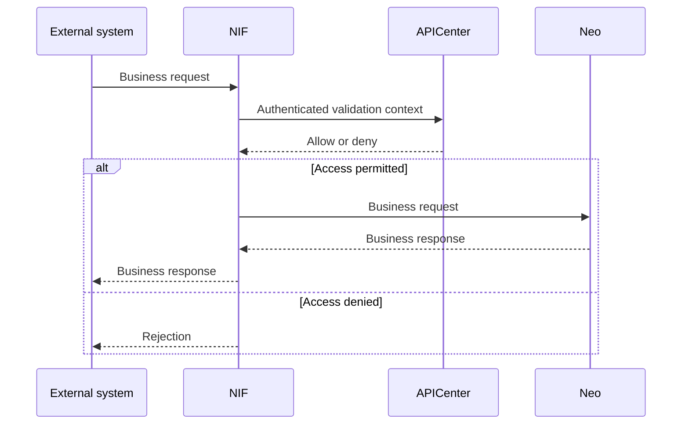

# Neo custom API licensing: design options and implementation plan

**Prepared:** 26 October 2026  
**Scope:** NIF, APICenter, Neo product applications, PS workflows, and the separate in-house product licence manager.  
**Status:** Provisional technical design based on the supplied prompt; proposed business policies require agreement by the relevant licensing authority. No source code, schema, licence file, or REST contract was supplied for inspection.

## 1. Problem diagnosis and explicit assumptions

### Supplied facts

NIF receives external business requests and asks APICenter to validate the relevant API and trusted source. APICenter returns a decision; NIF forwards permitted requests to Neo. Separately, APICenter calls Neo REST endpoints to synchronize applied-licence details. The business payload does not need to pass through APICenter.

Core API catalogues depend on product versions; the APIs licensed to a customer are a subset of those catalogues. PS custom APIs are outside the central licence manager's catalogue. PS currently inserts records into an APICenter table also populated by core-licence synchronization. A replacement core licence causes absent records, including custom records, to become inactive.

### Diagnosis and interpretation

The immediate defect is **an overbroad reconciliation boundary**. A source reporting core licence rights is being allowed to withdraw records outside its authority. Absence is meaningful only within a known, complete, current, authoritative collection.

The existing active/inactive field also appears to conflate several questions. This is an interpretation to verify against the schema:

| Question | Intended meaning | What must not be inferred |
|---|---|---|
| Definition/discovery | What API identity and contract exist? | Existence does not grant a licence. |
| Entitlement | What usage rights were validly granted, to whom, and for how long? | A manual registration is not proof of a grant. |
| Deployment availability | Is this API installed and routable in this deployment? | A synchronization timeout does not establish removal. |
| Administrative disablement | Has an authorized operator explicitly blocked use? | A later licence import must not clear that block. |
| Trusted-source permission | May this particular trusted source use this API? | A product/custom licence does not automatically authorize every source. |

Fixing reconciliation does not itself legalize historical custom access. Conversely, applying a core licence is not evidence that someone intended to revoke independently governed custom rights.

### Implementation assumptions

1. APICenter's code and deployment configuration can be modified. Database and Neo changes may need separate releases; each option states its requirements.
2. Its existing persistence technology supports transactions, uniqueness, and either locking or compare-and-set updates. Examples are logical models and pseudocode, not vendor-specific DDL.
3. The existing token, trusted-source, throttling, and other validation controls remain applicable. A trusted-source identifier is treated as an opaque existing domain identity; its authentication mechanism is deliberately unspecified.
4. The licence manager is outside the customer deployment. Its current encryption and verification mechanisms are unknown. Encryption alone is not assumed to establish issuer authenticity.
5. Stable customer, deployment, product, and API identifiers can be established. The actual identifier scheme and rehosting rules need confirmation.
6. A legitimate licensing authority can approve custom rights. PS developers and installers do not automatically possess that authority.
7. Service-to-service authentication can bind each configured Neo endpoint to its allowed deployment/product/content scope. Transport authentication establishes which system replied; it does not independently prove a commercial grant.

### Provisional business policies

Recommended policies, rather than claims about the current system, are: independently governed custom rights; an active compatible parent product licence by default; explicit module dependencies where commercially required; bounded disconnected operation; and reviewed, time-limited migration exceptions. Their consequences are developed below.



Synchronization runs as an independent management job, described in section 8. A business request does not trigger licence issuance or require a licence synchronization round trip.

## 2. Defect-remedy options

These options address who may update or withdraw synchronized records. Each can be introduced without deciding the final custom licensing model.

### D1 — Guard the existing updater with explicit ownership

**Mechanism.** Keep the existing table and runtime lookup initially. Restrict the core synchronizer to positively identified core-owned records for the configured customer/deployment/product. Add provenance columns if feasible, or use a protected, reviewed ownership registry keyed by existing stable row/API identifiers when a database migration is temporarily unavailable. A customer-editable `isCustom=true` flag is insufficient.

Determine ownership from prior authenticated synchronization history, the versioned core catalogue, PS release evidence, and review. Use the full catalogue where available, not just the customer's latest licensed subset. A once-licensed core API remains core-owned after it disappears from a licence response. Naming conventions can help investigation but are not proof of ownership or entitlement.

**API X example.** X has a reviewed PS/custom identity. A verified replacement core snapshot omits X. The updater does not touch X. A previously core-owned API Y omitted from that same complete, current snapshot loses its core licence status. Existing administrative blocks on X and Y stay in effect.

**Changes.** APICenter synchronization predicates, ownership lookup, dry-run reporting, and transactional updates change. Neo, NIF, and the licence manager need no immediate change. The registry can temporarily avoid changes to the business table, but every APICenter writer must use the same approved registry revision. A small provenance table is preferable to long-lived configuration exceptions.

```text
reconcileD1(configuredScope, response, ownershipRegistry):
    facts = validateLegacyResponse(response, configuredScope)
    require trustedOwnershipRegistry(ownershipRegistry)
    require currentAndComplete(facts) or reviewedAcceptanceOfExactDigest(facts)
    transaction:
        for api in facts.licensedApis:
            require confirmedCoreIdentity(api, configuredScope)
            updateCoreLicenceFieldsOnly(api)  // do not clear admin/source restrictions
        for row in rowsFor(configuredScope):
            if confirmedOwner(row) == configuredCoreSource
               and row.apiKey not in facts.licensedApis:
                withdrawCoreLicenceStatusOnly(row)
        // no updates to custom, unknown, another product, or trusted-source permission
```

If the old table has several rows per API/trusted source, withdraw the core licence contribution consistently across the appropriate rows. Do not delete the underlying source permissions. If its single flag cannot express a blocked API that is nevertheless licensed, calculate the compatibility flag from existing restrictions instead of blindly setting it to true.

**Legacy ambiguity and rollout.** Classify records as confirmed core, confirmed custom, unresolved, or conflicting. Confirmed custom means provenance is established, not that a licence has been granted. D1 preserves their present behavior while the entitlement migration is arranged. Unresolved records must not be relabelled custom because they are absent from a response. Keep them outside destructive automated reconciliation pending review; continued runtime use requires an explicit bounded migration policy. New unknown records receive no such treatment. A licence authority must approve any temporary access exception.

Shadow the proposed update set before activation. Restore a record already broken by this defect only after checking its historical successful use, deactivation cause, current source permissions, and any deliberate block. Never reactivate all inactive rows.

**Completeness/freshness limitation.** If the legacy endpoint supplies no reliable scope, completeness, or source revision, APICenter cannot manufacture those facts. A local job counter prevents local races but cannot detect an old server snapshot. Until evidence is available, require reviewed acceptance of the exact response digest tied to the current applied-licence event before a destructive change. An empty or smaller list is neither inherently invalid nor inherently trustworthy. This gate makes genuine core removal possible without treating an ambiguous response as a revocation. Network failures do not extend a licence's known validity.

**Advantages and remaining gaps.** Smallest code change; quick isolation of the defect; no Neo release required. Historical custom access still lacks a durable entitlement mechanism. The overloaded table remains fragile, and classification/configuration can become expensive. Incorrect ownership, bypassing writers, or a falsely complete legacy response remain principal failure cases.

**Effort and rollback.** Low code effort relative to the alternatives, with potentially substantial data review. Roll back through a previous safe updater that retains ownership guards. Preserve the registry, audit trail, expiry checks, and accepted revocations. Returning to the unrestricted updater would recreate the defect and is not an acceptable rollback.

### D2 — Separate source contributions and derive effective access

**Mechanism.** Introduce logical separation between definitions, entitlements, deployment facts, administrative blocks, and trusted-source permissions. Reconcile each authority's contribution independently. Core synchronization replaces only the core entitlement partition; custom entitlements or temporary migration exceptions have separate provenance and lifecycles.

An incremental implementation can add entitlement/provenance tables beside the current table and expose a compatibility projection to the existing validator. It does not require a separate service, new database, or an immediate rewrite of all portal features.

**API X example.** X's definition and custom entitlement or approved migration exception belong to a custom authority. Replacing the core partition leaves them intact. Effective access is recomputed using all applicable restrictions. If X's own entitlement expires, or its required parent product becomes unlicensed, access still stops.

**Changes.** APICenter gains a reconciliation service, partition/checkpoint storage, entitlement provenance, and a transactional effective-access query or projection. Its validator must read the new model or its safe compatibility projection. Neo's current endpoint can be adapted without changing its contract if its semantics are established. NIF and the central licence manager can remain unchanged. Existing source permissions must be preserved during migration.

```text
reconcileD2(scope, response):
    facts = validatedAdapter(response, scope)
    require authoritativeCompleteCurrentSnapshot(facts)
    staged = stageCoreContribution(scope, facts)
    transaction with policyScopeAndStreamLock:
        require notStale(staged, currentCheckpoint)
        activateGeneration(scope, staged)
        // old membership stops contributing only within this same core scope
        recomputeEffectiveProjectionFromAllCurrentContributions()
        advancePolicyRevisionAndAudit()
```

**Scope of withdrawal.** A complete snapshot can withdraw memberships only in the declared core entitlement collection. It does not remove API definitions, another product's contributions, local disablement, or custom grants. Deltas require explicit removals. An inventory disappearance changes deployment availability, not historical grant evidence.

**Legacy ambiguity and rollout.** Import source evidence and permissions into a shadow model. Unproven manual rows become legacy review candidates, not approved entitlements. Represent any authorized interim continuation as an explicit, expiring migration exception with its original narrow access scope. Compare both models before switching readers. Permit a single canonical writer; dual writing to the old table is safe only as a compatibility projection inside the same transaction.

**Restrictions and outage prevention.** The structural change need not initially change decisions. Requiring authentic custom entitlements is a separate, announced enforcement phase. Existing deliberate blocks must produce the same denial in both models. Unreviewed access cannot be promised permanent continuity while also claiming strict licensing.

**Advantages and remaining gaps.** Makes ownership and denial causes explicit; supports several granting mechanisms; prevents one stream from erasing another; improves auditability. More schema and validator work than D1. A bad join, an asynchronously stale authorization projection, or a second legacy writer can introduce failures. D2 does not repair an ambiguous REST contract: an unversioned source still needs D1's guarded legacy adapter.

**Effort and rollback.** Medium to high APICenter effort, depending on how much logic assumes the original flag. Use additive migrations and cohort reader switches. A rollback can select the transactional compatibility projection and D1 updater while retaining entitlement evidence, revocation tombstones, and watermarks. Never collapse verified expiry/revocation back into an unconditional active flag.

### D3 — Make source authority and replacement semantics explicit in REST

**Mechanism.** Change Neo's synchronization contract so that APICenter receives typed, scoped, versioned snapshots or deltas. Distinguish core entitlement facts from core definitions, custom discovery, and deployment availability. The source is authorized for specific content domains; a `CORE_ENTITLEMENT` response cannot withdraw custom entitlement records.

Each collection has a stable stream identity, durable source epoch/revision, declared mode, completeness information, and an authenticated integrity envelope. Source revisions are allocated consistently across Neo replicas and survive ordinary restarts. A timestamp or node-local counter is insufficient.

**API X example.** Neo returns `CORE_ENTITLEMENT`, product P, complete snapshot revision 42. X belongs to custom definition/entitlement authorities and is outside that collection. Its absence has no effect. Core Y's absence withdraws Y's core entitlement. A custom inventory removal, if separately reported by the authorized deployment source, can make X unavailable without pretending to revoke its licence.

**Changes.** Neo adds a versioned endpoint/export and coherent snapshot generation. APICenter verifies and persists stream checkpoints, handles paging/deltas, and applies typed changes. Small checkpoint/provenance additions are normally needed; D2's full model is useful but is not a prerequisite. NIF and the core licence manager do not change for this defect remedy. The endpoint must derive its claims from a trusted licence-verification path; signing a reply containing arbitrary unverified rows would not solve licensing.

```text
reconcileD3(expectedScope, envelope):
    verifySourceIdentityAuthorityIntegrityAndScope(envelope, expectedScope)
    verifySchemaPagesAndSnapshotDigest(envelope)
    transaction with scope lock:
        rejectOldEpochRevisionOrConflictingDuplicate(envelope)
        if envelope.mode == SNAPSHOT:
            require envelope.complete == true
            replaceMembershipOnly(expectedScope, envelope.entries)
        else if envelope.mode == DELTA:
            require envelope.baseRevision == currentRevision
            applyOnlyExplicitAuthorizedUpsertsAndRemovals(envelope)
        else:
            reject()
        commitCheckpointProjectionAuditTogether()
```

**Legacy ambiguity and rollout.** Neo cannot legitimize unknown manual APICenter rows by emitting a cleaner response. Review and classify them as in D1/D2. Run v2 read-only alongside v1, comparing current licence identities and content before changing the active writer. Keep unknown records outside automatic cross-scope deletion and enforce only approved bounded exceptions during migration.

**Behavior, advantages, and gaps.** Correctly scoped existing access is preserved. Actual removals and verified revocations are enforceable without guessing; legitimate empty snapshots and recoverable delta gaps become explicit. Contract changes span teams and product versions. Incorrectly declared completeness by a trusted but buggy producer, revision reset after disaster recovery, inconsistent paging, and unauthorized scope claims remain failure cases requiring contract tests and controls. D3 establishes trustworthy reconciliation semantics; it does not create a commercial entitlement for a discovered custom API.

**Effort and rollback.** Medium to high cross-component effort, usually greater coordination than D1. Roll back to the legacy endpoint through the guarded adapter only. Retain source watermarks and revocations; prevent an old v1 response from overwriting newer accepted state. Where freshness cannot be demonstrated, require reviewed acceptance or suspend destructive reconciliation.

## 3. Defect-remedy comparison and selection

| Dimension | D1: guarded updater | D2: separate contributions | D3: explicit source protocol |
|---|---|---|---|
| Main change | Bound existing mutations by proven ownership | Separate facts and calculate access | Make source scope, completeness, and ordering explicit |
| APICenter database | Optional business-table change; protected registry can bridge | New logical structures and reader/projection | Checkpoints/provenance normally needed; full normalization optional |
| Neo / REST change | None immediately | None if legacy semantics are adequate | Required |
| Immediate custom continuity | Preserves reviewed existing behavior | Preserves an independent custom contribution | Core stream cannot affect custom scope |
| Genuine core removal | Withdraw only confirmed core rights after trustworthy acceptance | Replace only the core entitlement partition | Complete current snapshot absence or explicit delta removal |
| Legacy response ambiguity | Guarded/manual acceptance for destructive changes | Same limitation until protocol improves | Explicitly addressed; producer correctness still matters |
| Complete licensing solution | No | No, until grants are introduced | No |
| Relative effort | Low code; data review may dominate | Medium–high APICenter work | Medium–high, coordinated product work |
| Strongest use case | Urgent containment; Neo release unavailable | Sustainable APICenter model with several authorities | Frequent changes, paging, multi-cluster races, strict revocation evidence |

**Best immediate remedy: D1**, provided ownership is reviewed and destructive reconciliation is gated when the old endpoint cannot establish freshness/completeness.

Choose D2 early when database changes are available and the same flag already drives licensin